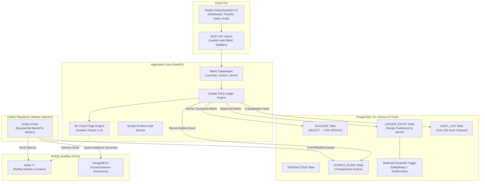

# Financial Transaction Ledger with Real-Time Fraud Triage

[](https://www.python.org/downloads/)
[](https://fastapi.tiangolo.com)
[](https://www.postgresql.org/)
[](https://redis.io/)
[](https://www.mongodb.com/)
[](https://www.docker.com/)
[](https://opensource.org/licenses/MIT)

An enterprise-grade, academic DBMS implementation simulating an **ACID-compliant digital payment ledger** with **real-time ML fraud triage**, **append-only SHA-256 hash-chained audit trails**, and **eventual consistency via the transactional outbox pattern**.

Repository: [Financial-Transaction-Ledger-with-Real-Time-Fraud-Triage-](https://github.com/praneel24eb-cyber/Financial-Transaction-Ledger-with-Real-Time-Fraud-Triage-)

---

## 📑 Table of Contents

- [Architectural Overview](#-architectural-overview)
- [System Architecture Diagram](#-system-architecture-diagram)
- [Key Engineering Pillars](#-key-engineering-pillars)
  - [1. ACID Double-Entry Bookkeeping](#1-acid-double-entry-bookkeeping)
  - [2. Deadlock-Free Concurrency Control](#2-deadlock-free-concurrency-control)
  - [3. Real-Time ML Fraud Triage & Fail-Safe Fallback](#3-real-time-ml-fraud-triage--fail-safe-fallback)
  - [4. Tamper-Evident SHA-256 Audit Log](#4-tamper-evident-sha-256-audit-log)
  - [5. Transactional Outbox & NoSQL Synchronization](#5-transactional-outbox--nosql-synchronization)
  - [6. Role-Based Access Control (RBAC)](#6-role-based-access-control-rbac)
- [Repository Structure](#-repository-structure)
- [Database Schema & Partitioning](#-database-schema--partitioning)
- [Interactive UI Dashboard](#-interactive-ui-dashboard)
- [API Reference](#-api-reference)
- [Quickstart & Execution Guide](#-quickstart--execution-guide)
  - [Option A: Docker Compose (Recommended)](#option-a-docker-compose-recommended)
  - [Option B: Local Environment Setup](#option-b-local-environment-setup)
- [Verification & Benchmarks](#-verification--benchmarks)
  - [1. Pytest Test Suite](#1-pytest-test-suite)
  - [2. Concurrency & Deadlock Prevention Demo](#2-concurrency--deadlock-prevention-demo)
  - [3. Database Performance Reports](#3-database-performance-reports)
- [License](#-license)

---

## 🏛 Architectural Overview

This system addresses core distributed transaction and data-integrity challenges faced by modern fintech platforms:

1. **Relational Source of Truth (PostgreSQL 15+)**: All monetary movements obey fundamental double-entry principles (every debit has an equal credit). Zero negative balances, strict foreign keys, and partition pruning on ledger entries.
2. **In-Memory Speed Layer (Redis 7+)**: Low-latency rolling velocity tracking (e.g., transaction count per 1-hour window) to feed real-time feature extractors.
3. **NoSQL Document Store (MongoDB 6+)**: Unstructured fraud evidence documents and historical risk analytics synchronized asynchronously.
4. **Predictive Safety (Scikit-Learn Isolation Forest)**: Real-time unsupervised anomaly scoring that categorizes transfers into `APPROVE`, `APPROVE & ALERT`, or `ROLLBACK & FLAG` with deterministic fallback protection.

---

## 📐 System Architecture Diagram



---

## ⚡ Key Engineering Pillars

### 1. ACID Double-Entry Bookkeeping
- Every transfer operation generates a balanced pair: exactly one `DEBIT` and one `CREDIT` entry in `LEDGER_ENTRY`.
- Enforced at the database level via a PostgreSQL **deferred constraint trigger**:
  $$\sum \text{debits} = \sum \text{credits}$$
- Balance checks prevent overdrafts (`CHECK (balance >= 0)`).

### 2. Deadlock-Free Concurrency Control
- High-frequency transfers between account pairs in reverse directions (e.g., Alice $\to$ Bob and Bob $\to$ Alice simultaneously) can trigger circular wait deadlocks.
- The system enforces **deterministic ascending lock ordering** (`account_id ASC`) using `SELECT ... FOR UPDATE`:
  ```sql
  -- Always acquire lock on the lower account ID first
  SELECT account_id, balance FROM ACCOUNT 
  WHERE account_id IN (acc_min, acc_max) 
  ORDER BY account_id ASC 
  FOR UPDATE;
  ```
- Guarantees zero lost updates and prevents database deadlocks under high multi-threaded contention.

### 3. Real-Time ML Fraud Triage & Fail-Safe Fallback
- **Feature Pipeline**:
  - Transfer amount
  - 1-hour rolling velocity counter (cached in Redis)
  - 30-day historical mean deviation (calculated from PostgreSQL history)
  - Temporal signals (hour of day, night-time transfer flags)
  - New device / fingerprint mismatch indicator
- **Decision Engine**:
  - `Risk Score < 50`: **`APPROVE`** $\to$ Transaction completed immediately.
  - `50 <= Risk Score <= 80`: **`APPROVE & ALERT`** $\to$ Transfer allowed; `FRAUD_ALERT` generated for analyst triage.
  - `Risk Score > 80`: **`ROLLBACK & FLAG`** $\to$ Transaction rolled back; source account marked `FLAGGED`.
- **Fail-Safe Fallback**: If the model asset cannot be loaded or feature extraction fails, the transaction is **never blindly approved**. It safely defaults to `risk_score=65`, `decision='ALERT'`, and `model_version='FAILSAFE_FALLBACK'`.

### 4. Tamper-Evident SHA-256 Audit Log
- All mutations to sensitive tables (`ACCOUNT`, `TRANSACTION`, `LEDGER_ENTRY`) emit append-only audit records.
- Each audit record is cryptographically linked to its predecessor via SHA-256 hash chaining:
  $$\text{row\_hash} = \text{SHA256}(\text{prev\_hash} \parallel \text{table} \parallel \text{operation} \parallel \text{old\_json} \parallel \text{new\_json})$$
- The application database role possesses **`INSERT`-only permissions** on `AUDIT_LOG`.
- An integrated verification algorithm scans the chain and pinpoints the exact row ID if historical data was mutated or deleted.

### 5. Transactional Outbox & NoSQL Synchronization
- Avoids fragile Two-Phase Commit (2PC) or distributed locking.
- Ledger transactions insert an `OUTBOX_EVENT` record inside the same PostgreSQL transaction block.
- An asynchronous daemon worker polls `PENDING` outbox events and updates:
  - **Redis 7**: Atomic increments of velocity counters (`INCR`, `EXPIRE`).
  - **MongoDB 6**: Upserts immutable fraud evidence documents (`txn_id` unique index).
- Implements exponential backoff with a 5-attempt retry limit.

### 6. Role-Based Access Control (RBAC)
Endpoints enforce privilege tiers via the `X-User-Role` HTTP header:
- **`customer`**: Transfer execution, account balance lookup, own transaction history.
- **`analyst`**: Access fraud review queues, investigate alert details, submit alert resolution (`CONFIRMED_FRAUD` / `FALSE_POSITIVE`).
- **`admin`**: Trigger audit chain cryptographic validation, inspect benchmark reports, seed synthetic data.

---

## 📁 Repository Structure

```
DBMS/
├── backend/
│   ├── app/
│   │   ├── api/                 # FastAPI API route controllers
│   │   │   ├── accounts.py      # Account balance and status endpoints
│   │   │   ├── admin.py         # Administrative & benchmark report endpoints
│   │   │   ├── audit.py         # Audit log query and hash verification endpoints
│   │   │   ├── customers.py    # Customer KYC management
│   │   │   ├── fraud.py        # Fraud alerts and analyst review workflows
│   │   │   ├── security.py     # Role-based access control (RBAC) dependencies
│   │   │   └── transactions.py # Transfer execution and double-entry handlers
│   │   ├── database/            # Database DDL, triggers & initial data
│   │   │   ├── schema.sql       # PostgreSQL 15+ table schemas & partitions
│   │   │   ├── triggers.sql     # Deferred balance triggers & audit hooks
│   │   │   └── seed.py          # Synthetic dataset seeder & model initiator
│   │   ├── fraud/               # ML feature extraction & Isolation Forest model
│   │   │   ├── features.py      # Real-time feature extraction pipeline
│   │   │   ├── infer.py         # Risk scoring & 3-tier triage inference
│   │   │   ├── train.py         # Isolation Forest model training script
│   │   │   └── isolation_forest.joblib # Serialized model binary
│   │   ├── models/              # Pydantic validation schemas
│   │   ├── repositories/        # Database, Redis & MongoDB client wrappers
│   │   │   ├── db.py            # PostgreSQL connection pool & transaction manager
│   │   │   ├── mongo_repo.py    # MongoDB fraud evidence repository
│   │   │   └── redis_repo.py    # Redis velocity counter repository
│   │   ├── services/            # Core business & ledger logic
│   │   │   ├── audit_service.py # SHA-256 hash chaining & verification
│   │   │   └── ledger_service.py# Double-entry execution & row-level locking
│   │   ├── workers/             # Transactional outbox asynchronous processor
│   │   │   └── outbox_worker.py # Background poller & retry dispatcher
│   │   ├── config.py            # Application settings and environment variables
│   │   └── main.py              # Application entrypoint & Jinja2 UI mount
│   └── frontend/
│       ├── static/              # Dark glassmorphism stylesheet & assets
│       │   └── css/style.css    # Responsive theme styling
│       └── templates/           # Jinja2 server-rendered views
│           ├── alerts.html      # Analyst fraud review queue
│           ├── audit.html       # Cryptographic audit log inspector
│           ├── benchmarks.html  # Database benchmarks & EXPLAIN reports
│           ├── history.html     # Double-entry ledger audit history
│           ├── index.html       # System dashboard with live stats
│           └── transfer.html    # Funds transfer terminal with real-time triage
├── benchmarking/
│   ├── demo_concurrency.py      # Multi-threaded deadlock-prevention script
│   ├── explain_reports/         # Comprehensive database performance analyses
│   │   ├── index_benchmarks.md  # B-Tree index scan cost reductions
│   │   ├── isolation_benchmarks.md # Read Committed vs Serializable concurrency
│   │   ├── partition_benchmarks.md # Monthly partition pruning verification
│   │   └── redis_vs_sql_latency.md # Redis cache vs SQL aggregate speedups
│   └── pgbench_scripts/         # pgbench load-testing transactions
│       ├── read_history.sql
│       └── transfer.sql
├── docker/
│   ├── docker-compose.yml       # 4-container production topology
│   └── Dockerfile               # Backend container build specification
├── tests/                       # Pytest verification suite
│   ├── conftest.py              # Test database fixtures & offline bypass
│   ├── test_audit.py            # Cryptographic hash chain tamper tests
│   ├── test_concurrency.py      # Concurrent row locking & race condition tests
│   ├── test_fraud.py            # Fraud engine & fail-safe fallback tests
│   ├── test_ledger.py           # Double-entry balancing & overdraft tests
│   ├── test_outbox.py           # Outbox retry & NoSQL sync tests
│   └── test_security.py         # RBAC role gating tests
├── requirements.txt             # Python dependencies
├── .gitignore                   # Ignored files (virtualenvs, databases, logs)
└── README.md                    # Project documentation
```

---

## 🗄 Database Schema & Partitioning

The relational schema implements 11 normalized tables in PostgreSQL:

| Table | Purpose | Integrity Constraint |
|---|---|---|
| `CUSTOMER` | Customer identity & KYC status | `UNIQUE(email)`, `CHECK (kyc_status)` |
| `ACCOUNT` | Monetary balances | `CHECK (balance >= 0)`, Row-lock target |
| `DEVICE` | Fingerprint tracking for velocity & anomaly detection | FK to `CUSTOMER` |
| `MERCHANT` | Merchant directory & categories | ISO 2-letter country code |
| `TRANSACTION` | Transfer header & execution lifecycle | `CHECK (status IN ('PROCESSING', 'COMPLETED', 'ROLLED_BACK'))` |
| `LEDGER_ENTRY` | **Range-partitioned** double-entry book | Partitioned by `created_at` (Monthly ranges) |
| `FRAUD_RESULT` | ML score (0-100), model version, triage action | FK to `TRANSACTION` |
| `FRAUD_ALERT` | Actionable queue for high/medium severity alerts | `CHECK (severity IN ('MEDIUM', 'HIGH'))` |
| `ANALYST_REVIEW` | Audit trail of manual fraud reviews | `CHECK (decision)` |
| `AUDIT_LOG` | Tamper-evident cryptographic ledger | Append-only, SHA-256 hash-chained |
| `OUTBOX_EVENT` | Transactional outbox records | Status: `PENDING`, `SENT`, `RETRY`, `FAILED` |

### Partition Pruning Example
Queries filtering on date ranges automatically bypass non-relevant tables:
```sql
EXPLAIN ANALYZE
SELECT * FROM LEDGER_ENTRY 
WHERE created_at >= '2026-10-01' AND created_at < '2026-11-01';
-- Scans only `ledger_entry_y2026m10`, pruning all other monthly partitions.
```

---

## 🖥 Interactive UI Dashboard

The system includes a pre-built glassmorphism web interface accessible via browser:

- **Dashboard (`/`)**: Real-time overview of total active accounts, system balance, open fraud alerts, and pending outbox events.
- **Transfer Terminal (`/ui/transfer`)**: Interactive funds transfer console with live feedback displaying transaction status, ML risk score, and triage decision.
- **Ledger History (`/ui/history`)**: Filterable transaction book with balanced debit/credit pairs.
- **Fraud Alert Desk (`/ui/alerts`)**: Fraud analyst console to inspect flagged transactions and resolve open alerts (`CONFIRMED_FRAUD` / `FALSE_POSITIVE`).
- **Audit Log Inspector (`/ui/audit`)**: Real-time hash chain viewer featuring an interactive **Verify Hash Chain** button that highlights tamper events.
- **Benchmark Reports (`/ui/benchmarks`)**: Database latency, indexing, and isolation reports rendered directly in the browser.

---

## 🔌 API Reference

### Core Endpoints

| Method | Endpoint | Allowed Roles | Description |
|---|---|---|---|
| `POST` | `/api/v1/transactions/transfer` | `customer`, `admin` | Executes double-entry funds transfer with real-time fraud triage |
| `GET` | `/api/v1/accounts/{id}/balance` | `customer`, `admin` | Returns current account balance and active status |
| `GET` | `/api/v1/accounts/{id}/ledger` | `customer`, `admin` | Retrieves ledger entries for an account |
| `GET` | `/api/v1/fraud/alerts` | `analyst`, `admin` | Lists open fraud triage alerts |
| `POST` | `/api/v1/fraud/alerts/{id}/review` | `analyst`, `admin` | Submits fraud analyst determination |
| `GET` | `/api/v1/audit/logs` | `admin` | Retrieves tamper-evident audit records |
| `POST` | `/api/v1/audit/verify` | `admin` | Validates SHA-256 chain continuity across all records |
| `GET` | `/api/v1/admin/benchmarks` | `admin` | Returns database benchmark reports and metrics |

Interactive OpenAPI documentation is available at `http://localhost:8000/docs`.

---

## 🚀 Quickstart & Execution Guide

### Option A: Docker Compose (Recommended)

Spin up the entire stack (PostgreSQL 15, Redis 7, MongoDB 6, FastAPI backend) with one command:

```bash
docker-compose -f docker/docker-compose.yml up --build
```

- Web UI: **`http://localhost:8000`**
- Interactive Swagger API: **`http://localhost:8000/docs`**
- PostgreSQL: Port `5432` (db: `ledger_db`, user: `ledger_user`, pass: `ledger_password`)
- Redis: Port `6379`
- MongoDB: Port `27017`

### Option B: Local Environment Setup

1. **Clone the repository**:
   ```bash
   git clone https://github.com/praneel24eb-cyber/Financial-Transaction-Ledger-with-Real-Time-Fraud-Triage-.git
   cd Financial-Transaction-Ledger-with-Real-Time-Fraud-Triage-
   ```

2. **Create and activate a virtual environment**:
   ```bash
   python -m venv .venv
   # Windows:
   .venv\Scripts\activate
   # Linux/macOS:
   source .venv/bin/activate
   ```

3. **Install dependencies**:
   ```bash
   pip install -r requirements.txt
   ```

4. **Configure environment variables** (or create a `.env` file):
   ```env
   POSTGRES_HOST=localhost
   POSTGRES_PORT=5432
   POSTGRES_DB=ledger_db
   POSTGRES_USER=ledger_user
   POSTGRES_PASSWORD=ledger_password
   REDIS_HOST=localhost
   REDIS_PORT=6379
   MONGO_URI=mongodb://localhost:27017
   MONGO_DB_NAME=fraud_triage_db
   ```

5. **Initialize PostgreSQL database & schema**:
   ```bash
   psql -U ledger_user -d ledger_db -f backend/app/database/schema.sql
   psql -U ledger_user -d ledger_db -f backend/app/database/triggers.sql
   ```

6. **Start the FastAPI application**:
   ```bash
   python -m backend.app.main
   ```

---

## 🧪 Verification & Benchmarks

### 1. Pytest Test Suite
Run the automated test suite covering double-entry balancing, concurrency, cryptographic audit chaining, fraud triage, and RBAC:
```bash
python -m pytest -v tests/
```

### 2. Concurrency & Deadlock Prevention Demo
Execute the multi-threaded race condition benchmark:
```bash
python benchmarking/demo_concurrency.py
```
This script launches concurrent threads transferring funds in opposite directions between the same account pair, confirming:
- **Zero deadlocks** due to deterministic ascending lock ordering (`account_id ASC`).
- **Zero lost updates** and precise preservation of total system balance.

### 3. Database Performance Reports
The `benchmarking/explain_reports/` directory contains full `EXPLAIN ANALYZE` reports:
- **`isolation_benchmarks.md`**: Empirical throughput and latency across `Read Committed`, `Repeatable Read`, and `Serializable`.
- **`index_benchmarks.md`**: Query execution cost reductions achieved with composite indexing.
- **`partition_benchmarks.md`**: Partition pruning verification across monthly ranges.
- **`redis_vs_sql_latency.md`**: Latency comparison between Redis in-memory velocity counters ($<1\text{ ms}$) and repeated SQL aggregations ($24\text{ ms}$).

---

## 📄 License

This project is licensed under the MIT License — see the [LICENSE](LICENSE) file for details.
